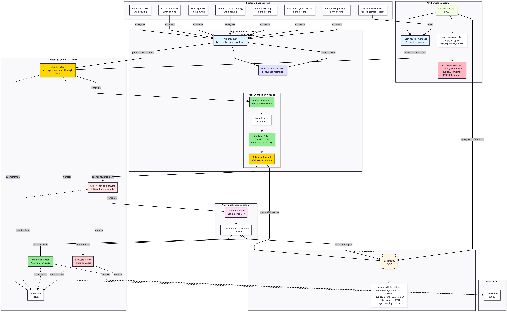
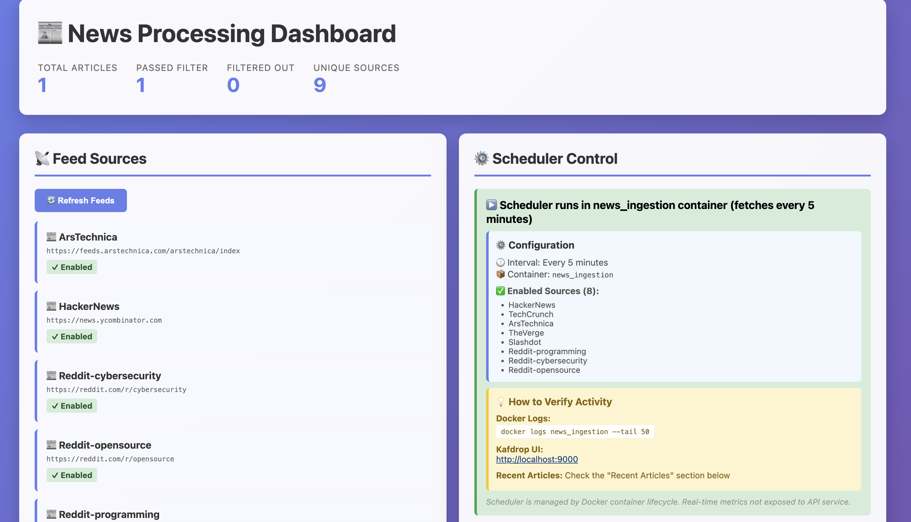
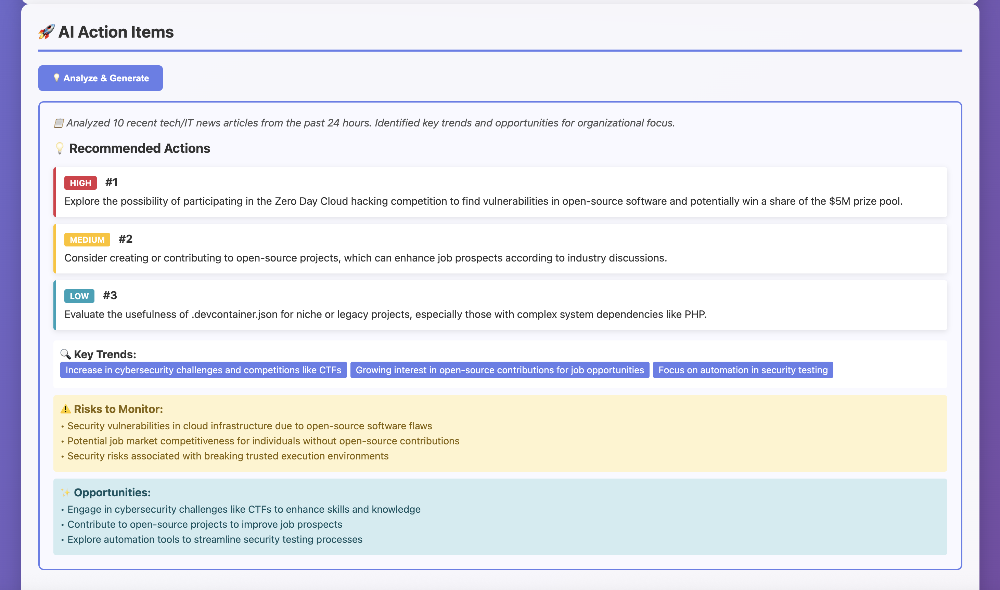

# News Intelligence Pipeline

[](https://github.com/NtaylorOX/news-intel-pipeline/actions/workflows/ci.yml)


An event-driven pipeline that ingests IT news from 9+ sources, filters it with a hybrid **heuristic + LLM classifier**, and turns what survives into ranked articles, per-article analysis and prioritised action items. Built as a set of small services around Kafka so ingestion, filtering and (slow, rate-limited) LLM analysis scale independently.



## Highlights

- **Event-driven microservices** – API, ingestion worker and analysis worker communicate only through Kafka topics (`raw_articles` → `article_needs_analysis` → `article_analyzed`), so the HTTP API acknowledges immediately and LLM latency never blocks ingestion.
- **Hybrid relevance filtering** – cheap keyword/quality heuristics run first and spam/too-short items never reach the LLM. With `AI_FILTER_ENABLED=true` the LLM returns a **Pydantic-validated structured output** (relevance score, quality score, reasoning), and explicit rules reconcile it with the heuristics (e.g. no tech keywords requires AI relevance ≥ 0.8). Every decision is inspectable via `/filter-results/{id}`.
- **Deterministic, explainable ranking** – results are ranked by relevance × recency by default; classification runs at temperature 0 so the same batch produces the same result.
- **Deduplication** – content hashing before storage so re-polled feeds and cross-posted stories don't inflate results.
- **LLM insights** – an `/insights/action-items` endpoint summarises recent coverage into prioritised actions, key trends, risks and opportunities.
- **Operable** – Docker Compose stack with health checks, Kafdrop for topic inspection, a web dashboard, and horizontally scalable analysis workers.

| Dashboard | LLM action items |
|---|---|
|  |  |

## How it works

```
Client / scheduler (every 5 min: RSS, HackerNews, Reddit)
        │
        ▼
[API service]  POST /api/ingestion/ingest ──► Kafka: raw_articles      (returns 200 immediately)
        │
        ▼
[Ingestion worker]  dedupe ─► heuristic filter ─► LLM relevance check ─► PostgreSQL
        │
        ▼
Kafka: article_needs_analysis ──► [Analysis worker(s)]  LLM analysis ─► PostgreSQL
        │
        ▼
GET /api/ingestion/retrieve  ──► filtered articles ranked by relevance × recency
```

| Component | Tech |
|---|---|
| API | FastAPI (async), Pydantic |
| Messaging | Apache Kafka 7.5 (+ Kafdrop UI) |
| Storage | PostgreSQL 15, SQLAlchemy |
| LLM | LangChain + OpenAI (`gpt-4o-mini` by default, configurable in `app/core/ai_config.yaml`) |
| Packaging / infra | uv, Docker Compose, GitHub Actions |

## Quick start

**Prerequisites:** Docker with Compose, and an OpenAI API key.

```bash
git clone https://github.com/NtaylorOX/news-intel-pipeline.git
cd news-intel-pipeline
cp .env.example .env          # then set OPENAI_API_KEY (AI_FILTER_ENABLED=true turns on the LLM filter)
docker compose up -d --build
```

| Service | URL |
|---|---|
| Dashboard | http://localhost:8000/dashboard |
| API docs (Swagger) | http://localhost:8000/api/docs |
| Kafdrop (Kafka UI) | http://localhost:9000 |

Try it with one relevant and one irrelevant article:

```bash
curl -X POST http://localhost:8000/api/ingestion/ingest \
  -H "Content-Type: application/json" \
  -d '[
    {"id": "tech-1", "source": "test", "title": "Kubernetes patches critical RBAC bypass",
     "body": "Maintainers released emergency patches for an authentication bypass in the API server...",
     "published_at": "2025-11-05T09:00:00Z"},
    {"id": "food-1", "source": "test", "title": "The perfect chocolate chip cookie",
     "body": "Mix butter, sugar, flour and chocolate chips, then bake for 12 minutes...",
     "published_at": "2025-11-05T09:30:00Z"}
  ]'

sleep 5 && curl http://localhost:8000/api/ingestion/retrieve   # only tech-1 is returned
```

Scale the LLM analysis stage independently:

```bash
docker compose up -d --scale analysis-worker=3
```

See **[docs/API.md](docs/API.md)** for the full endpoint reference, configuration files and environment variables.

## Development

```bash
uv sync --group dev
uv run pytest
```

The test suite (43 tests) covers the filtering, deduplication and AI services, with the LLM mocked, so it runs offline with no API key; those three modules sit at roughly 70–90% line coverage. CI runs the tests on Python 3.11 and 3.12 and builds every service image.

```
app/
  api/endpoints/   FastAPI routers (ingestion, news, insights, dashboard)
  core/            config, prompts, DB models, YAML configs
  services/        AI service, filtering, deduplication, Kafka, fetchers, scheduler
services/          entrypoints + Dockerfiles for api / ingestion / analysis
scripts/           inspect_filters.py – CLI view of filter decisions
tests/             pytest suite
```

## Design notes and next steps

- **Why Kafka rather than a task queue?** Ingestion and analysis have very different throughput (feeds vs. rate-limited LLM calls); topics give back-pressure, replay and independent consumer scaling.
- **Why heuristics before the LLM?** Most obviously off-topic items are rejected for free, which cuts LLM cost and latency while keeping the LLM for ambiguous cases.
- **Next:** a labelled evaluation set to report filter precision/recall, swappable local models (e.g. via Ollama) behind the same structured-output interface, and integration tests against the Compose stack.

## License

[MIT](LICENSE)
